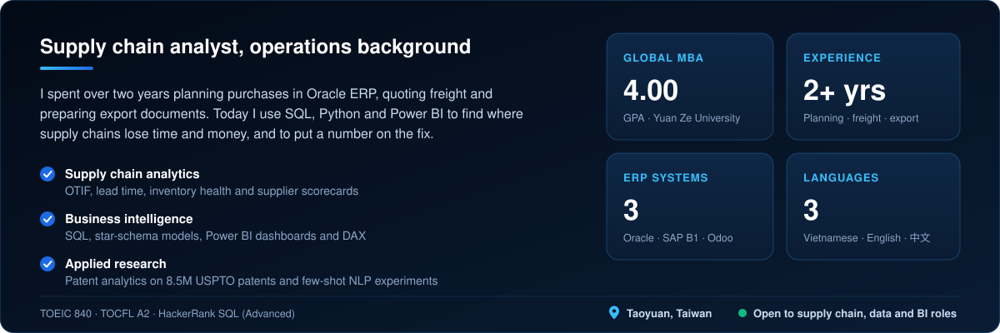
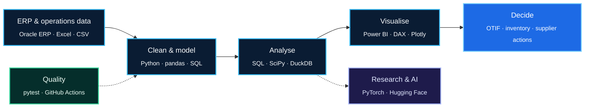

  

  

  &nbsp;
  &nbsp;
  &nbsp;
  

 

 

<table>
  <tr>
    <td align="center" valign="top" width="200">
       
      Jan 2023 – Jul 2023 
      <b>Viet Logistics</b> 
      Export &amp; Import Trainee
    </td>
    <td align="center" valign="middle">➜</td>
    <td align="center" valign="top" width="200">
       
      Jul 2023 – Aug 2024 
      <b>Kodai Sangyo (Vietnam)</b> 
      Sales Logistics Staff
    </td>
    <td align="center" valign="middle">➜</td>
    <td align="center" valign="top" width="200">
       
      Oct 2024 – Apr 2025 
      <b>Hoa Sen Group</b> 
      Supply Chain Planner
    </td>
    <td align="center" valign="middle">➜</td>
    <td align="center" valign="top" width="200">
       
      Feb 2025 –  
      <b>Yuan Ze University</b> 
      Global MBA · GPA 4.00
    </td>
  </tr>
</table>

| Role | Highlights |
|---|---|
| **Supply Chain Planner**, Hoa Sen Group | Purchase orders for imported and domestic goods · inventory control in Oracle ERP · stock standards for warehouses nationwide · operational reporting |
| **Sales Logistics Staff**, Kodai Sangyo | Air and ocean freight quotations · reefer schedules · customs, C/O and phytosanitary coordination · contracts and receivables |
| **Export & Import Trainee**, Viet Logistics | Shipping documents (invoice, packing list, C/O, SI, VGM) · HS codes · carrier booking · Incoterms |

  &nbsp; <b>B.Eng. Logistics &amp; Supply Chain Management</b>, HCMC University of Technology and Engineering (2020 – 2024) · GPA 8.46 / 10 · Distinction

| Project | Business result | Stack |
|---|---|---|
| [**E-Commerce Cohort & Retention**](https://github.com/Haven-Pham/ecommerce-cohort-retention-analysis) | Sales +24% but profit −12% in 2023; repeat buyers are 31% of customers and 56% of profit; deep discounts lost $289K | Python · pandas · pytest · CI |
| [**F&B Supply Chain Analytics**](https://github.com/Haven-Pham/fnb-supply-chain-analytics) | Strict OTIF 89.4% vs 95% target; two suppliers cause 55% of late orders; $64K revenue at risk | Python · Power BI · 37 DAX measures |
| [**Transport OTIF Turnaround**](https://github.com/Haven-Pham/transport-logistics-otif-analytics) | 3,582 GPS-tracked trips; early-warning score with 72% precision and 82% recall | Python · SciPy · Power BI |
| [**ProtoSetFit**](https://github.com/Haven-Pham/ProtoSetFit) | Controlled few-shot NLP ablation, 45+ GPU runs, frozen-test evaluation (team project) | PyTorch · Hugging Face |
| [**Customer Analytics Playbook**](https://github.com/Haven-Pham/customer-analytics-playbook) | EDA, Pareto, ABC, RFM, market basket, funnel and Sankey analyses | pandas · Plotly · mlxtend |
| [**Portfolio Website**](https://github.com/Haven-Pham/Portfolio) | Four-language site with a Google Sheets CMS and a live GitHub feed | HTML · CSS · JavaScript |

> **Master's thesis (2026)** · *Tracing Technology Convergence Through Patent Analysis: Longitudinal Evidence from USPTO Patents, 1976–2025*
>
> Built a Python and DuckDB pipeline over **8.53M utility patents** to track how **188,661 technology pairs** first converge and later recur, and compared Gompertz, logistic and exponential growth models on a 2020–2025 holdout.

<table width="100%">
  <tr>
    <td width="24%"><b>Analytics &amp; BI</b></td>
    <td>
      
      
      
      
      
      
      
    </td>
  </tr>
  <tr>
    <td><b>AI &amp; Research</b></td>
    <td>
      
      
      
      
      
      
    </td>
  </tr>
  <tr>
    <td><b>Supply Chain &amp; ERP</b></td>
    <td>
      
      
      
    </td>
  </tr>
  <tr>
    <td><b>Engineering</b></td>
    <td>
      
      
      
      
    </td>
  </tr>
</table>

  
  
  
  
  

All 22 certificates, with verification links, are listed on the [portfolio website](https://haven-portfolio02.vercel.app/?scroll=certifications).

  
  

 

<picture>
  <source media="(prefers-color-scheme: dark)" srcset="https://raw.githubusercontent.com/Haven-Pham/Haven-Pham/output/github-snake-dark.svg">
  
</picture>

**Latest repositories** (updated daily by GitHub Actions)

<!-- LATEST-REPOS:START -->
| Repository | Description | Language | Last push |
|---|---|---|---|
| [**Portfolio**](https://github.com/Haven-Pham/Portfolio) |  | Jupyter Notebook | 2026-10-28 |
| [**customer-analytics-playbook**](https://github.com/Haven-Pham/customer-analytics-playbook) |  | Jupyter Notebook | 2026-10-28 |
| [**ProtoSetFit**](https://github.com/Haven-Pham/ProtoSetFit) |  | Jupyter Notebook | 2026-10-28 |
| [**transport-logistics-otif-analytics**](https://github.com/Haven-Pham/transport-logistics-otif-analytics) |  | Jupyter Notebook | 2026-10-28 |
| [**fnb-supply-chain-analytics**](https://github.com/Haven-Pham/fnb-supply-chain-analytics) |  | Jupyter Notebook | 2026-10-28 |
| [**ecommerce-cohort-retention-analysis**](https://github.com/Haven-Pham/ecommerce-cohort-retention-analysis) | Cohort, retention & profitability analysis of 51K e-commerce order lines: Python, pandas, tests and CI | Jupyter Notebook | 2026-10-27 |
<!-- LATEST-REPOS:END -->

 

  

