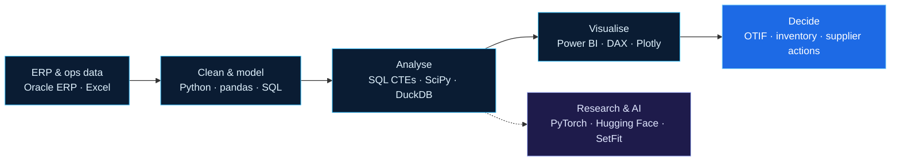

<a href="https://haven-portfolio02.vercel.app"></a>

<p align="center">
  <a href="https://haven-portfolio02.vercel.app"></a>
</p>

<p align="center">
  <a href="https://haven-portfolio02.vercel.app"></a>
  <a href="https://www.linkedin.com/in/havenpham"></a>
  <a href="mailto:havenpham63729@gmail.com"></a>
  <a href="https://haven-portfolio02.vercel.app/assets/Pham_Hong_Hieu_CV_DRAFT.pdf"></a>
</p>

---

## 👋 About me

```yaml
name: Pham Hong Hieu (Haven · 范鴻孝)
based_in: Taoyuan, Taiwan
role: Supply Chain & Data Analyst
education:
  - Global MBA, Yuan Ze University (2025 – present) · GPA 4.00/4.00 · Rank 1/28 (semester 2)
  - B.Eng. Logistics & Supply Chain Management, HCM-UTE (2020 – 2024) · GPA 8.46/10 · Distinction
focus:
  - Supply chain analytics: OTIF, inventory, supplier performance
  - BI: SQL, Python, Power BI star schemas and DAX
  - Research: patent analytics (technology convergence) and few-shot NLP
languages: [Vietnamese (native), English (TOEIC 840), Mandarin (TOCFL A2)]
```

## 💼 Experience

| Period | Role | Company | Highlights |
|---|---|---|---|
| Oct 2024 – Apr 2025 | **Supply Chain Planner** | Hoa Sen Group · Vietnam | Purchase orders for imported and domestic goods, inventory control in **Oracle ERP**, nationwide stock standards, operational reporting |
| Jul 2023 – Aug 2024 | **Sales Logistics Staff** | Kodai Sangyo (Vietnam) | Freight quotations (air/ocean), reefer schedules, customs/C/O/phyto coordination, contracts and receivables |
| Jan 2023 – Jul 2023 | **Export & Import Trainee** | Viet Logistics | Shipping documents (invoice, P/L, C/O, SI, VGM), HS codes, carrier booking, Incoterms |

## 🚀 Featured projects

| Project | What it shows | Stack |
|---|---|---|
| 🔁 [**E-Commerce Cohort & Retention**](https://github.com/Haven-Pham/ecommerce-cohort-retention-analysis) | 2023 sales +24% but profit −12%; repeat buyers = 31% of customers, 56% of profit; deep discounts lost $289K | Python · pandas · pytest · CI |
| 🥬 [**F&B Supply Chain Analytics**](https://github.com/Haven-Pham/fnb-supply-chain-analytics) | Strict OTIF 89.4% vs 95% target; 2 suppliers cause 55% of late orders; $64K revenue at risk | Python · Power BI · 37 DAX measures |
| 🚚 [**Transport OTIF Turnaround**](https://github.com/Haven-Pham/transport-logistics-otif-analytics) | 3,582 GPS trips; flat ETA makes long-haul infeasible; early-warning score 72% precision / 82% recall | Python · SciPy · Power BI |
| ✦ [**ProtoSetFit**](https://github.com/Haven-Pham/ProtoSetFit) | Controlled 2×2 few-shot NLP ablation, 45+ GPU runs, frozen-test evaluation, exact permutation tests | PyTorch · SetFit · Hugging Face |
| 📊 [**Customer Analytics Playbook**](https://github.com/Haven-Pham/customer-analytics-playbook) | EDA, Pareto, ABC, RFM, cohort, market basket, funnel and Sankey notebooks | pandas · Plotly · mlxtend |
| 🌐 [**Portfolio website**](https://github.com/Haven-Pham/Portfolio) | 4-language static site, Google Sheet CMS, live GitHub feed, CI-synced content | HTML · CSS · JS · Apps Script |

## 🔬 Research

- **Master's thesis (2026):** *Tracing Technology Convergence Through Patent Analysis: Longitudinal Evidence from USPTO Patents, 1976–2025*. 8.53M utility patents, 188,661 technology pairs, Gompertz/logistic/exponential growth models with a 2020–2025 holdout.

<sub>Summary only; the full thesis is shared on request.</sub>

## 🧰 Tech stack



**Analytics & BI** &nbsp;


**AI & research** &nbsp;


**Supply chain & ERP** &nbsp;


## 🏅 Certifications


-F59E0B?style=flat-square)

All 22 documents, with verification links, are on the [portfolio website](https://haven-portfolio02.vercel.app/?scroll=certifications).

## 🆕 Latest repositories

<!-- LATEST-REPOS:START -->
_Updated automatically by GitHub Actions._
<!-- LATEST-REPOS:END -->

## 📈 GitHub activity

<p align="center">
  
  
</p>

<p align="center">
  <picture>
    <source media="(prefers-color-scheme: dark)" srcset="https://raw.githubusercontent.com/Haven-Pham/Haven-Pham/output/github-snake-dark.svg">
    
  </picture>
</p>

---

<p align="center">
  <sub>Open to supply chain analyst, data analyst and BI opportunities.<br>
  Full profile, case studies and certificates: <a href="https://haven-portfolio02.vercel.app"><b>haven-portfolio02.vercel.app</b></a></sub>
</p>
